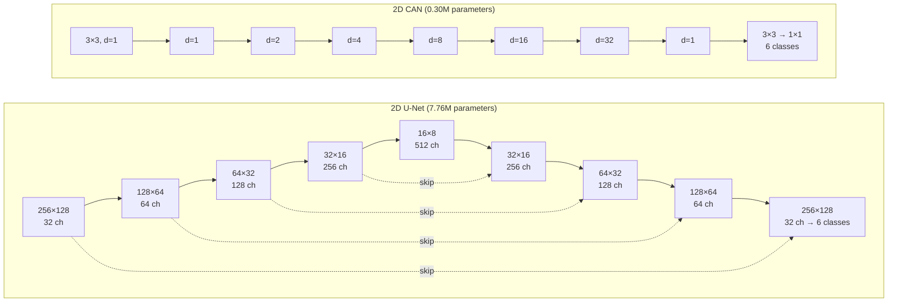
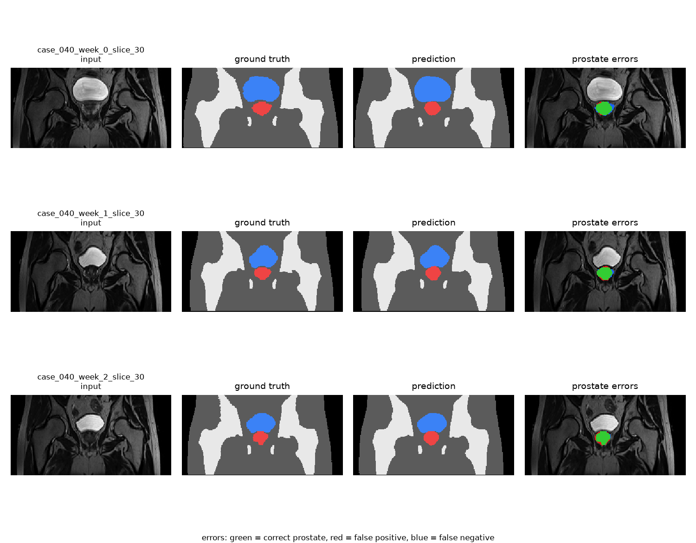
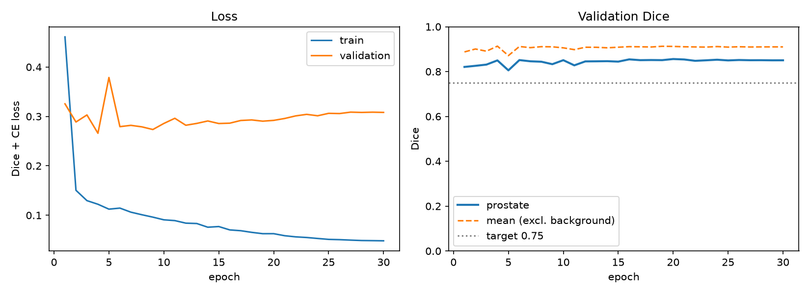
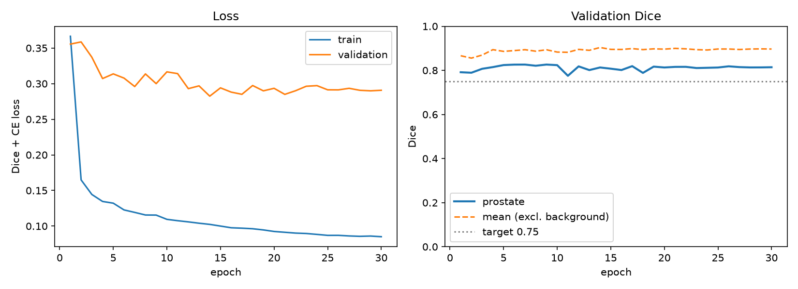
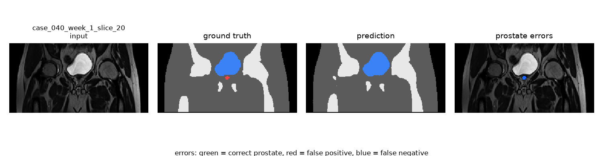
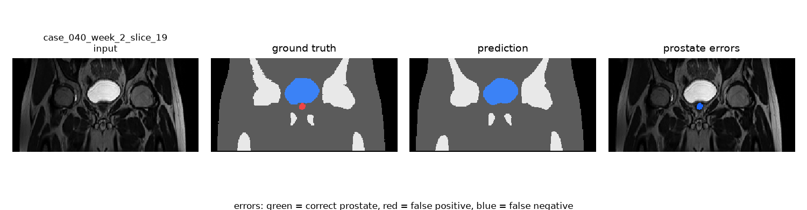
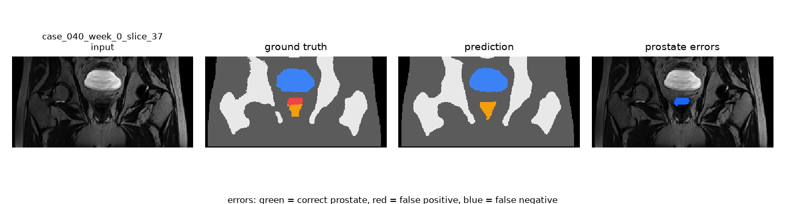
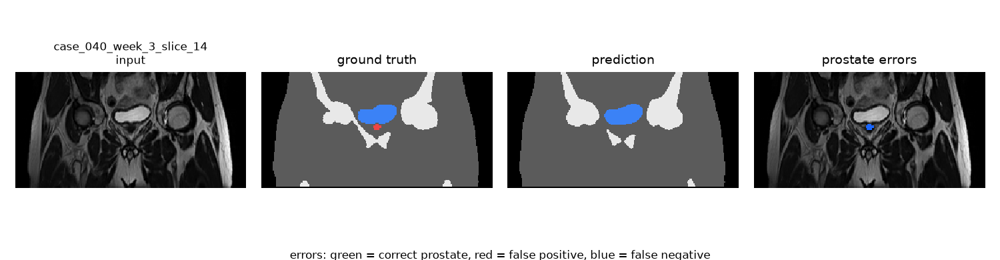

# HipMRI 2D Prostate Segmentation: U-Net vs Context Aggregation Network

**Author:** Xiaoyu Zhang (s49834905) · **Course:** COMP3710, The University of Queensland · **Difficulty:** Normal (2D CAN on HipMRI), with a 2D U-Net baseline

## Overview

### The problem

Radiotherapy for prostate cancer needs the prostate and the organs around it outlined on MRI before a dose can be planned. Contouring by hand is slow, so an automatic first draft that a clinician only corrects would save time. This project segments 2D pelvic MRI slices from the HipMRI Study into six classes (background, body, bone, bladder, rectum, prostate) and evaluates whether the result is safe to use as a draft. The assignment target is a prostate Dice of at least 0.75 on the held-out test set.

### How it works

Two convolutional networks are trained and compared on the same patient-level split. The **baseline, a 2D U-Net** [1], shrinks the image four times to see the whole pelvis, then upsamples back to full size, with skip connections restoring the detail lost while shrinking. The **main model, a 2D Context Aggregation Network (CAN)** [2], never shrinks the image: it stacks 3×3 convolutions whose sampling points are spread further apart in each layer (dilations 1, 2, 4, 8, 16, 32, 1), so the receptive field grows to about 133 pixels while every prediction is made at full resolution. Both output six class scores per pixel and are trained with cross-entropy plus soft Dice loss.



*Every CAN layer stays at 256×128 with 64 channels; d is the dilation rate.*



*Central test slices from the U-Net: input, ground truth, prediction, and prostate errors (green correct, red false positive, blue false negative). Images are rotated 90° for display so the bladder sits above the prostate.*

**Headline result:** both models clear the target comfortably (U-Net 0.861, CAN 0.853 prostate Dice, mean of three seeds), but both collapse to about 0.4 Dice on the first and last slices where the prostate appears. Multi-scale context does not fix this; see the [dilemma investigation](#open-research-dilemma-investigation).

## Feasibility Review

*Presented to the tutor at the Week 13 practical check-off; reproduced here as required.*

**User:** radiotherapy planners contouring the prostate and nearby organs on pelvic MRI. **Purpose:** a prototype that drafts multi-class contours slice by slice for a clinician to review and correct.

**Dilemma:** a model can score a good global Dice on easy central slices while failing at the boundaries of the gland or leaking into the rectum or bladder, which are the clinically dangerous errors.

**Acceptance criteria**

1. **Accuracy:** prostate Dice ≥ 0.75 on the held-out test split.
2. **Worst case:** per-volume prostate Dice reported for every test scan; the worst scan must be ≥ 0.70.
3. **Edge slices:** prostate Dice reported separately for the first and last two slices of each volume that contain prostate; the main model must not be worse than the baseline there.
4. **Leakage:** share of predicted-prostate pixels inside ground-truth rectum or bladder, reported and compared with the baseline.
5. **Resource:** peak training VRAM ≤ 4 GB and inference ≤ 1 s per 60-slice volume on an RTX 4080 Laptop GPU.

**Model choice and course concepts:** a 2D U-Net baseline and a 2D CAN main model, chosen because the HipMRI dilemma asks specifically whether multi-scale context removes boundary errors. Relevant concepts: convolution and receptive fields, encoder–decoder design, class imbalance (prostate is 0.43% of training pixels) handled with a Dice term in the loss, and patient-level splitting.

**Preliminary evidence:** the data audit below, and a baseline U-Net run reaching 0.855 test prostate Dice with 0.86 GB peak training VRAM.

**Risks and fallback:** the evaluation sets are small (4 validation and 3 test patients), so per-volume scores are reported rather than only pooled Dice. Compute budget is under one GPU-hour per model. If CAN missed the target, the fallback was to submit the U-Net (Easy) and report CAN as a negative result.

**Outcome against the criteria (mean of three seeds):** criteria 1, 2, 4 and 5 are met by both models. Criterion 3 is **not met** by CAN: its edge-slice Dice (0.385) is below the baseline's (0.425). 

**Tutor feedback at the check-off** and where it is addressed: keep a sufficient commit history (the work is committed in small steps); compare 2D and 3D models on the same scale (costs and Dice are reported per volume, see [Resource profiling](#resource-profiling)); and group the failure cases to see whether they share a cause (see [Failure case autopsy](#failure-case-autopsy)).

## Dataset and Preprocessing

**Data:** HipMRI Study 2D slices (`keras_slices_data`), 38 patients and 211 3D volumes, each stored as 60 coronal slices of 256×128 pixels with six-class masks. Viewed upright, the bladder lies above the prostate and the femoral heads sit on either side.

**Data audit** (run on Rangpur before training):

| Check | Result |
|---|---|
| Patient-level split | train 31 / validate 4 / test 3 patients, no patient in two splits |
| Slices | 11,460 / 660 / 540 (191 / 11 / 9 volumes) |
| Size outliers | one training volume (`case_019_week_1`) is 256×144 |
| Class imbalance | prostate in 36.2% of training slices and 0.43% of training pixels |
| Test composition | 7 of the 9 test volumes are repeat scans of patient 040 |

**Split justification:** the official split is used unchanged because it is already patient-disjoint, which was checked by extracting patient IDs from every filename. Splitting at the slice level would place near-identical neighbouring slices, or other weekly scans of the same patient, on both sides, and the test score would then measure memorisation of that patient's anatomy rather than generalisation to new patients.

**Preprocessing** (`dataset.py`):

- **Normalisation:** each slice is z-score normalised (zero mean, unit variance), following `normImage` in the assessment specification's `load_data_2D`. Raw intensities range up to about 470 and differ between scans.
- **Size:** the one 256×144 volume is centre-cropped to 256×128, removing 8 columns of body tissue from each side. Cropping avoids the label interpolation that resizing would introduce, and only training data is affected.
- **Masks** are rounded to integer labels 0–5 and stored as `uint8`; one-hot encoding happens inside the loss.
- **Augmentation (training only):** random left–right flip with probability 0.5, which mirrors the roughly symmetric pelvis. Superior–inferior flips are not used because an upside-down pelvis never occurs.
- All slices are loaded into memory once (about 1.9 GB for training), so epochs do not re-read thousands of compressed files.

## Model Architecture

### Baseline: 2D U-Net

Four encoder levels, each a 2×2 max-pool followed by two 3×3 convolutions with batch normalisation and ReLU, doubling channels from 32 to 512. Four decoder levels each upsample with a 2×2 transposed convolution, concatenate the encoder feature map of the same size, and apply two more 3×3 convolutions. A final 1×1 convolution gives six class scores. Unlike the original paper [1], convolutions are padded so the output keeps the input size and no cropping is needed. 7,762,630 parameters.

### Main model: 2D CAN

Following the context module of Yu and Koltun [2]: one 3×3 convolution lifts the single input channel to 64 features, seven 3×3 convolutions with dilations 1, 2, 4, 8, 16, 32 and 1 aggregate context, one more 3×3 convolution refines, and a 1×1 convolution gives six class scores. Each convolution is followed by batch normalisation and LeakyReLU (slope 0.2). Padding equals the dilation, so every layer keeps the full 256×128 resolution. 297,030 parameters, 26 times fewer than the U-Net.

### Loss and training

- **Loss:** cross-entropy plus multi-class soft Dice, `L = CE + (1 − mean_c Dice_c)`. Cross-entropy gives stable per-pixel gradients early on; the Dice term weights every class equally regardless of size, which stops the 0.43%-of-pixels prostate from being ignored.
- **Optimiser:** Adam, learning rate 1e-3 with cosine annealing over 30 epochs, batch size 16, mixed precision.
- **Model selection:** after each epoch the model is evaluated on the validation split, and the checkpoint with the best validation prostate Dice is kept. The test split is used once, at the end, on that checkpoint.
- **Evaluation Dice** is "hard" Dice on argmax predictions, with intersections and areas summed over the whole split before dividing.

## Dependencies and Reproducibility

| Package | Version |
|---|---|
| Python | 3.11.17 |
| PyTorch | 2.14.1+cu132 |
| NumPy | 2.4.6 |
| nibabel | 5.4.2 |
| matplotlib | 3.11.2 |
| tqdm | 4.70.1 |

**Hardware:** NVIDIA GeForce RTX 4080 Laptop GPU (12 GB), Windows, NVIDIA driver supporting CUDA 13.3.

**Reproducibility:** `train.py` fixes the Python and PyTorch random seeds (`--seed`, default 42), which control weight initialisation, shuffling and augmentation. Two runs with the same seed and model produced an identical first epoch; later epochs differed only because those runs used different epoch counts, which changes the cosine learning-rate schedule. Bit-exact repeats are not guaranteed, since some cuDNN kernels are non-deterministic. To show how much results depend on the seed, every model was trained with seeds 42, 1 and 2, and results are reported as mean ± standard deviation.

## Usage

The code expects the data folder containing the six `keras_slices_*` subfolders. Pass it with `--root` (the default is the author's local path).

```bash
# 1. Check the data pipeline: split sizes, batch shapes, label range, slice sizes
python dataset.py --root /path/to/keras_slices_data

# 2. Check both models build and produce (B, 6, 256, 128) outputs
python modules.py

# 3. Train (results go to outputs/<name>/: best_model.pt, history.json, curves.png, test_results.json)
python train.py --root /path/to/keras_slices_data --model unet --epochs 30 --seed 42
python train.py --root /path/to/keras_slices_data --model can  --epochs 30 --seed 42 --out outputs/can30

# 4. Evaluate a checkpoint and save metrics.json plus figures to <checkpoint folder>/eval/
python predict.py --root /path/to/keras_slices_data --model unet
python predict.py --root /path/to/keras_slices_data --model can --checkpoint outputs/can30/best_model.pt

# 5. Aggregate the six runs into mean ± SD per model
python compare.py

# 6. Group prostate slices by size and print mean Dice and failure rate per group
python analyse_failures.py
```

| File | Contents |
|---|---|
| `dataset.py` | file pairing, NIfTI loading, normalisation, centre-crop, augmentation, DataLoaders, self-test |
| `modules.py` | `UNet` and `CAN` model classes, parameter counting, shape self-test |
| `train.py` | Dice + cross-entropy loss, training and validation loop, checkpointing, curves, final test |
| `predict.py` | inference, per-class / per-volume / edge-slice / leakage metrics, timing, error figures |
| `compare.py` | reads the six runs' metrics.json and prints mean ± SD per model |
| `analyse_failures.py` | groups prostate slices by size and prints mean Dice and failure rate per group |

## Results

### Training curves





*Seed 42, 30 epochs. Left: training and validation loss. Right: validation prostate Dice and mean Dice over the five foreground classes; the dotted line is the 0.75 target.*

Both models plateau early. The U-Net reaches its best validation prostate Dice region by epoch 4; afterwards its training loss keeps falling (0.46 → 0.05) while its validation loss rises (0.27 → 0.31), a sign of mild overfitting that checkpoint selection guards against. The CAN reaches its plateau by epochs 6–9, with a flat validation loss. Doubling CAN's training from 15 to 30 epochs changed its test prostate Dice by only 0.003 (0.847 → 0.850), so it was not undertrained. Validation scores jump by up to 0.05 between epochs, because the validation split has only four patients.

### Per-class test results

Mean ± standard deviation over seeds 42, 1 and 2.

| Class | U-Net Dice | CAN Dice |
|---|---|---|
| Background | 0.996 ± 0.002 | 0.996 ± 0.000 |
| Body | 0.984 ± 0.000 | 0.983 ± 0.000 |
| Bone | 0.935 ± 0.002 | 0.931 ± 0.001 |
| Bladder | 0.964 ± 0.002 | 0.963 ± 0.002 |
| Rectum | 0.843 ± 0.015 | 0.831 ± 0.012 |
| **Prostate** | **0.861 ± 0.007** | **0.853 ± 0.002** |

Prostate IoU: U-Net 0.757 ± 0.010, CAN 0.743 ± 0.003. Per-class IoU for every run is saved in `outputs/<run>/eval/metrics.json`.

Both models exceed the 0.75 target under every seed (lowest single run: U-Net 0.855, CAN 0.850).

## Open Research Dilemma Investigation

The HipMRI dilemma asks whether multi-scale context genuinely removes boundary and slice-transition errors, or only smooths easy central slices at a higher computational cost. To answer it, `predict.py` reports more than pooled Dice.

### Quantitative benchmarking

Test split, mean ± standard deviation over three seeds. **Edge slices** are, for each volume, the first two and last two slices whose ground truth contains prostate (36 slices in total); **central slices** are the remaining 159 prostate slices.

| Metric | U-Net (baseline) | CAN (main) | Better |
|---|---|---|---|
| Prostate Dice, all slices | **0.861 ± 0.007** | 0.853 ± 0.002 | ≈ U-Net |
| Prostate Dice, central slices | **0.880 ± 0.006** | 0.873 ± 0.000 | ≈ |
| **Prostate Dice, edge slices** | **0.425 ± 0.035** | 0.385 ± 0.042 | U-Net (both poor) |
| Worst test volume, prostate Dice | **0.838 ± 0.012** | 0.802 ± 0.014 | U-Net |
| Predicted prostate inside true rectum | **0.14% ± 0.07%** | 0.26% ± 0.13% | U-Net |
| Predicted prostate inside true bladder | **0.53% ± 0.32%** | 0.81% ± 0.17% | U-Net |
| Prostate predicted on prostate-free slices (of 345) | 3.7 ± 3.1 | 6.0 ± 1.0 | U-Net, but variable |

**Findings**

1. **Central slices are solved by both models** (Dice about 0.88) and the difference between them there is within seed noise.
2. **Edge slices fail for both models**, at about 0.4 Dice, less than half the central score. A pooled Dice of 0.86 hides this completely.
3. **Multi-scale context does not help at the edges.** CAN is slightly worse than the U-Net on edge slices, on the worst volume, on leakage and on spurious detections, in the mean of three seeds. Its full-resolution design did not translate into sharper boundaries.
4. The U-Net's edge Dice varies more across seeds (0.388 to 0.457), so a single training run can over- or under-state edge performance by about 0.04.

### Resource profiling

Measured on the RTX 4080 Laptop GPU.

| | U-Net | CAN |
|---|---|---|
| Trainable parameters | 7,762,630 | **297,030** |
| Peak training VRAM (batch 16) | **0.86 GB** | 1.27 GB |
| Training time per epoch | **31–38 s** | 47–57 s |
| Peak inference VRAM (batch of 60 slices) | 1.55 GB | **1.41 GB** |
| Inference time per 60-slice volume | **0.089 ± 0.009 s** | 0.136 ± 0.014 s |

CAN has 26 times fewer parameters but needs about 50% more training memory and time, and is about 50% slower at inference. Parameter count is the wrong measure of cost here: CAN applies 64-channel convolutions to all 32,768 pixels in every layer, whereas most of the U-Net's work happens on downsampled feature maps. Both models meet the resource criterion with a wide margin.

Inference cost is reported per 60-slice volume (a batch of 60 slices is exactly one volume), and Dice is also reported per volume, so these numbers can be compared directly with a future 3D model, which processes a whole volume at once.

### Failure case autopsy

**Grouping failures by prostate size.** To check whether failures share a common cause or are random, every test slice containing prostate was grouped by how many ground-truth prostate pixels it holds (`analyse_failures.py`, all six runs pooled). A slice counts as failed when its prostate Dice is below 0.5.

| Prostate pixels in slice | Slices | U-Net Dice | U-Net failed | CAN Dice | CAN failed |
|---|---|---|---|---|---|
| 1–50 | 14 | 0.091 | 90% | 0.063 | 98% |
| 51–150 | 28 | 0.427 | 50% | 0.339 | 62% |
| 151–300 | 44 | 0.773 | 11% | 0.718 | 15% |
| over 300 | 109 | 0.895 | 0% | 0.891 | 0% |

Failure rate falls steadily as the prostate gets larger, and no slice with more than 300 prostate pixels failed for either model. The failures are therefore not random noise: both models are unreliable whenever the prostate occupies fewer than about 150 pixels of the slice, and CAN is worse than the U-Net in every small-prostate group. Because the gland is thinnest at its edges, this also explains the low edge-slice Dice above. The individual cases below are examples of this pattern.

The five worst prostate slices of each of the six trained models (two architectures × three seeds) are largely **the same slices**: `case_040_week_1_slice_20` appears for all six models, and `week_0_slice_37/38`, `week_2_slice_19`, `week_2_slice_37` and `week_3_slice_14` recur repeatedly. Failures that persist across architectures and seeds point to properties of the slices, not to a particular model. All of them are edge slices of patient 040.

**Case 1: `case_040_week_1_slice_20`, missed entirely (among the five worst slices for all six models).**



The ground-truth prostate is a small spot directly beneath the bladder, where the gland first appears in the slice direction. Both models label it as bladder or body. **Trigger:** at the edge of the gland, only a sliver of prostate falls inside the slice thickness, so its signal is mixed with neighbouring tissue (partial-volume effect) and is nearly indistinguishable from the bladder wall. A 2D model has no access to the adjacent slice where the prostate is obvious. **Clinical consequence:** under-contouring, which in radiotherapy risks under-dosing tumour tissue.

**Case 2: `case_040_week_2_slice_19`, the same failure in another weekly scan.**



The same patient, a week later, at the same edge of the gland: again a small ground-truth prostate under the bladder, again no prediction. That the error repeats across weekly scans shows it is systematic for this anatomy rather than random.

**Case 3: `case_040_week_0_slice_37`, prostate labelled as rectum.**



At the opposite edge of the gland, the ground truth shows a thin band of prostate sitting directly on top of the rectum. The U-Net labels the whole region as rectum. **Trigger:** this is the millimetre-thin prostate–rectum interface. On this slice the two tissues have similar intensity, and the rectum is the larger, more frequent structure in training, so the model resolves the ambiguity towards it. **Clinical consequence:** the prostate is under-contoured, and if a planner corrected it carelessly the boundary with the rectal wall would be uncertain, the situation that leads to radiation proctitis.

**Case 4: `case_040_week_3_slice_14`, missed edge slice with a smaller bladder.**



A different weekly scan, where the bladder is flatter and the gland's edge falls at an earlier slice index (14 rather than 19–20), yet the outcome is identical: a small ground-truth prostate under the bladder, nothing predicted (CAN shown). Edge failures happen regardless of how full the bladder is.

**A note on orientation.** The specification describes the failure mode as errors at the prostate **base and apex**. These slices are coronal, so the slice direction runs front to back, and the first and last slices containing prostate are its anterior and posterior surfaces, not base and apex. The base and apex lie at the top and bottom of the gland within each coronal slice. The underlying problem is the same: wherever the gland is thin relative to the slice, a single 2D slice does not carry enough information.

**Other observations**

- **Spurious detections** are rare: 1 to 7 of 345 prostate-free test slices get any prostate prediction. CAN produces them more consistently (5 to 7).
- **Leakage into organs is below 1%** for both models, so gross spill into the bladder or rectum is not the main hazard. The main hazard is missing tissue at the gland's edges.
- **Limitation:** 7 of the 9 test volumes are repeat scans of one patient (040), and every failure case comes from that patient. The edge-slice result therefore needs confirming on more patients before it can be generalised.

### Recommendation to the project manager

**Adopt the 2D U-Net for drafting, restricted to central slices, with mandatory manual review of the gland's edge slices. Do not adopt the CAN. Fund a 3D or 2.5D experiment next.**

- **Where automation works:** on central prostate slices both models reach about 0.88 Dice, the worst test volume stays at or above 0.83 (U-Net), and leakage into the rectum and bladder is under 1%. A clinician correcting these drafts would mostly adjust boundaries.
- **Where it breaks down:** on the first and last slices containing prostate, Dice falls to about 0.4 and the typical error is missing the prostate altogether or labelling it as rectum. These slices are unsuitable for automated drafting. In practice the planner should be shown the slice range where the draft's prostate starts and ends, and should check one or two slices beyond each end. More precisely, drafts are unreliable on any slice where the prostate covers fewer than about 150 pixels, which in practice means the slices at either end of the gland.
- **Why not CAN:** multi-scale context within the slice does not improve the edge slices (0.385 vs 0.425), the worst volume or leakage, and it costs about 50% more training memory and inference time. Its only advantage, a 26-fold smaller model, does not matter on this hardware.
- **What to try next:** the edge failures come from missing information in the slice direction, which in-plane context cannot supply. The next experiment should give the model neighbouring slices, either as extra input channels (2.5D, a cheap change to the current pipeline) or with a 3D U-Net on the volume data, and should be judged on the edge-slice metric defined here rather than on pooled Dice. It should also be tested on more patients than the current three.


**My reflection**

The main thing I learned is that a good overall Dice can hide where the model actually fails. The models perform badly on specific slices, the ones where the prostate is very small. One result surprised me: I expected the 2D CAN to do better than the 2D U-Net, but it was slightly worse. I also learned that a 3D model cannot be compared directly with a 2D one, because that would be unfair; the comparison has to be made on the same scale, per volume. With more time, I would complete a 3D model and test whether it fixes the small-prostate slices.

## Artificial Intelligence Usage Disclosure

**Tool used:** Claude (Anthropic), through the Claude app, throughout the project.

**What it assisted with**

- **Explanations:** U-Net and CAN architectures, dilated convolutions, Dice versus cross-entropy loss, PyTorch `nn.Module` and `DataLoader` usage, Git and conda set-up, and patient-level data leakage.
- **Code:** Claude wrote the initial drafts of `dataset.py`, `modules.py` (both models), `train.py` and `predict.py` from my data-audit findings and design decisions, and gave step-by-step instructions for the edits I made.
- **Debugging:** Claude identified bugs in code I edited, including a misplaced indentation in the centre-crop loop that would have silently left almost all training images as zeros, and a mistyped variable name.
- **Writing:** Claude drafted the feasibility review and this README from my experimental results, which I reviewed and edited.

**What I did**

- Ran the data audit on Rangpur (folder structure, filename patterns, patient-level overlap check) and copied the data locally.
- Chose the dataset, the Normal-difficulty route and the CAN main model, and agreed the acceptance criteria.
- Ran every experiment (6 training runs and their evaluations), read the outputs and inspected the prediction figures.
- Edited the code and documentation, and committed the work in stages.
- Wrote `compare.py` to aggregate the multi-seed results; it caught two standard deviations that an earlier draft of this README had computed from rounded values.
- Wrote `analyse_failures.py` in response to tutor feedback, grouping failures by prostate size to show they are systematic rather than random.

**How the AI-assisted code was verified**

- Every file has a self-test: `dataset.py` checks split sizes, batch shapes and dtypes, label range, and the size of every file; `modules.py` checks output shapes and parameter counts for both models.
- The scripts were first run on small synthetic data, then on the real data with a 2-epoch smoke test before full training.
- The patient-level split was checked independently with shell commands on Rangpur, outside the Python code.
- Results were checked for consistency: the proportion of slices containing prostate (36.2%) confirmed that normal slices were loaded correctly after the indentation bug was fixed, identical first epochs across repeated runs confirmed seeding, and three seeds per model confirmed that conclusions do not depend on one run.
- Prediction figures were inspected visually against the ground truth, which is also how the coronal orientation of the slices, previously mislabelled as axial, was caught and corrected.

## References

[1] O. Ronneberger, P. Fischer and T. Brox, "U-Net: Convolutional Networks for Biomedical Image Segmentation," in *Proc. MICCAI*, 2015, pp. 234–241.

[2] F. Yu and V. Koltun, "Multi-Scale Context Aggregation by Dilated Convolutions," in *Proc. ICLR*, 2016.

[3] COMP3710 Final Report Assessment specification, The University of Queensland, 2026, including the `load_data_2D` NIfTI loading reference code in Appendix B, from which the normalisation and extra-dimension handling in `dataset.py` are adapted.
